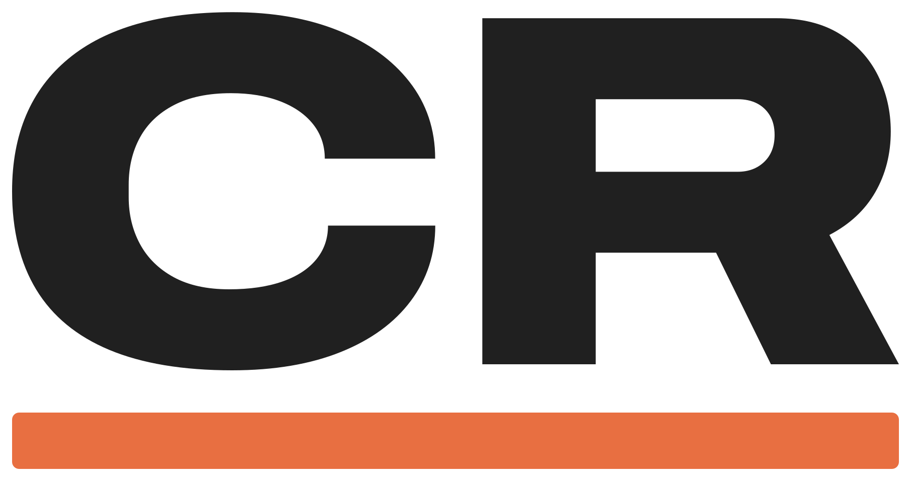
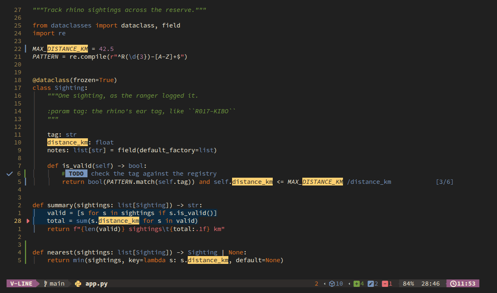
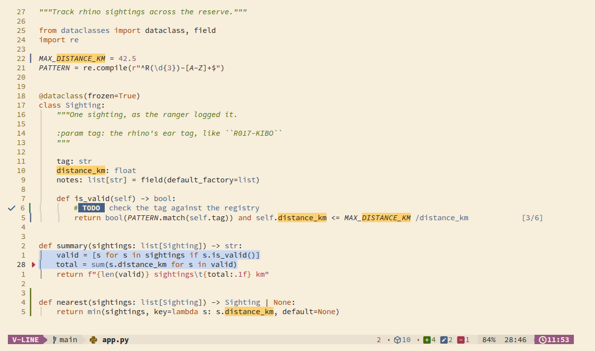
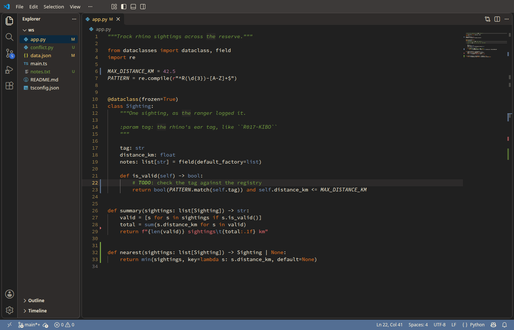
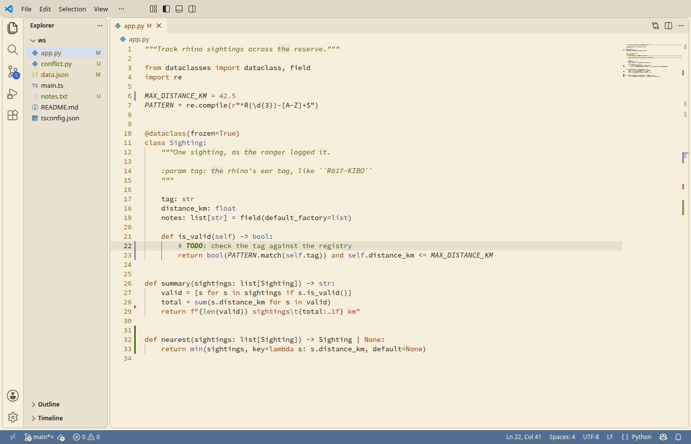
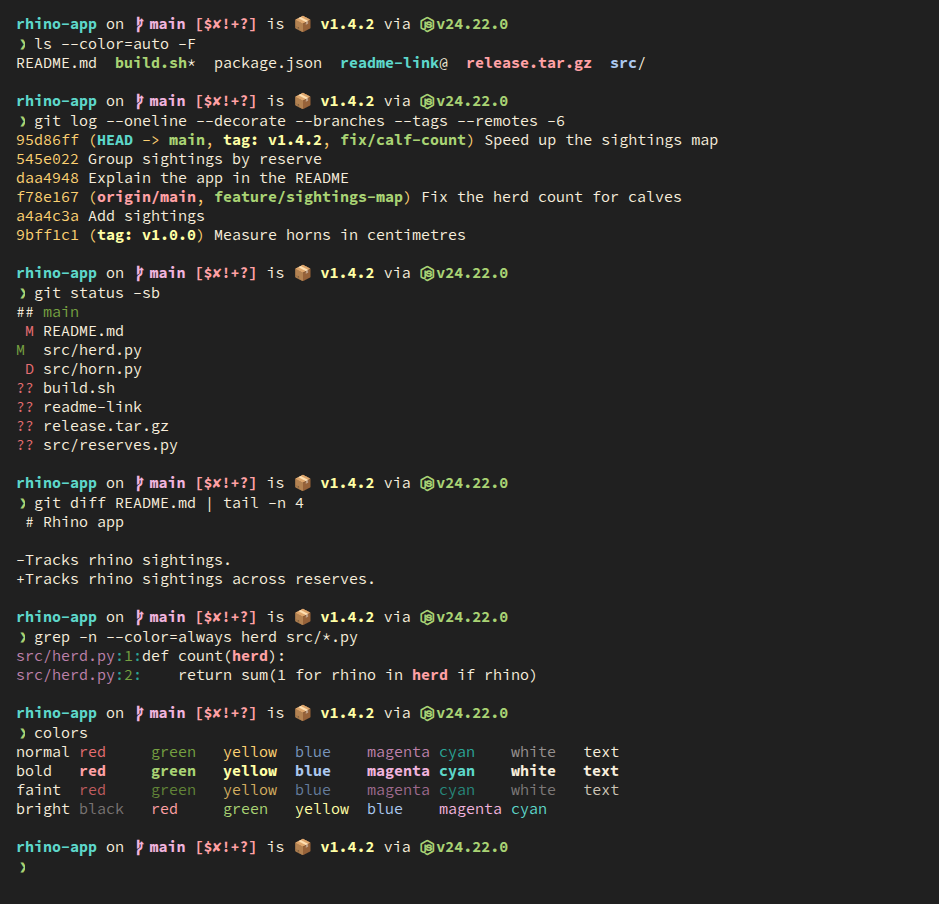
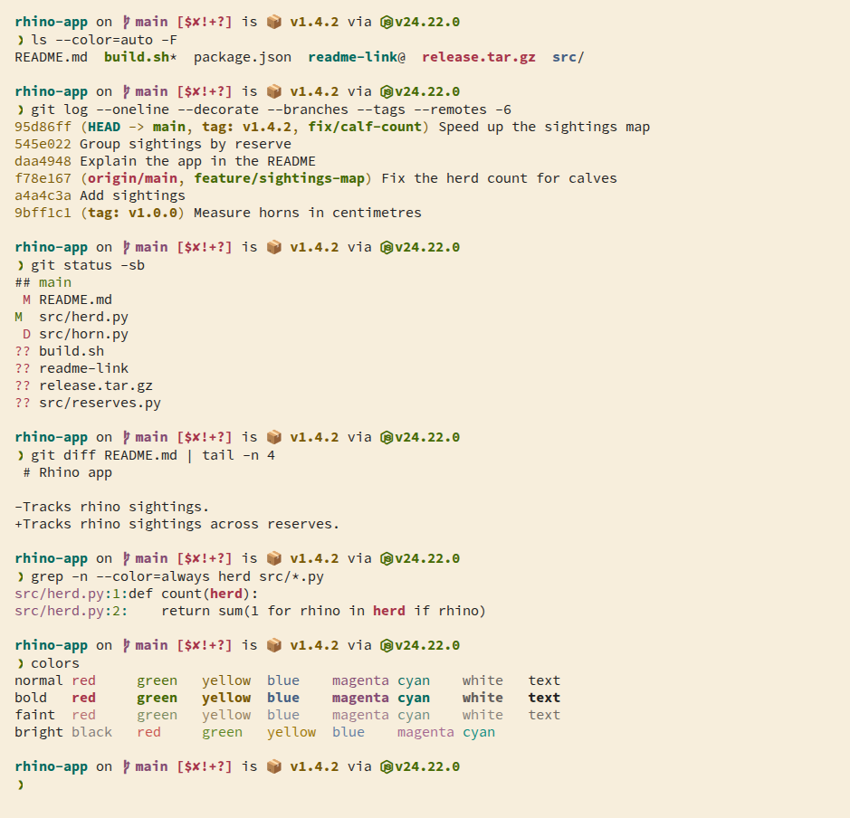
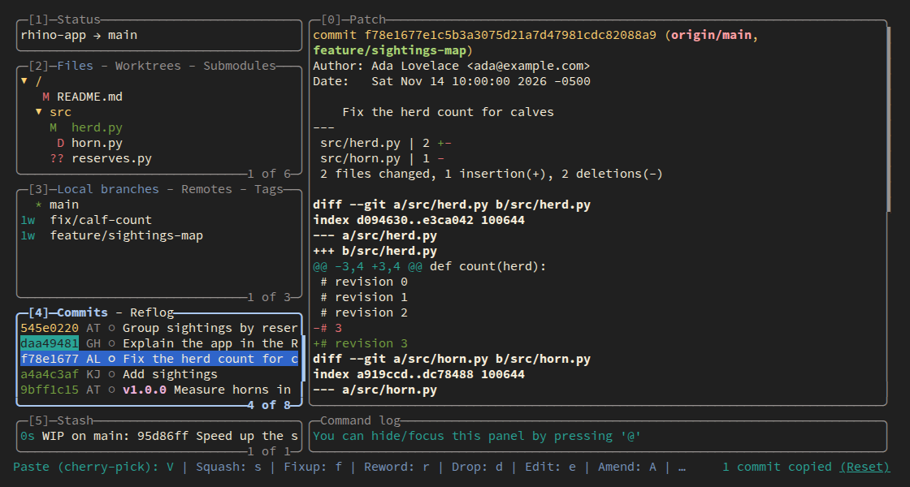
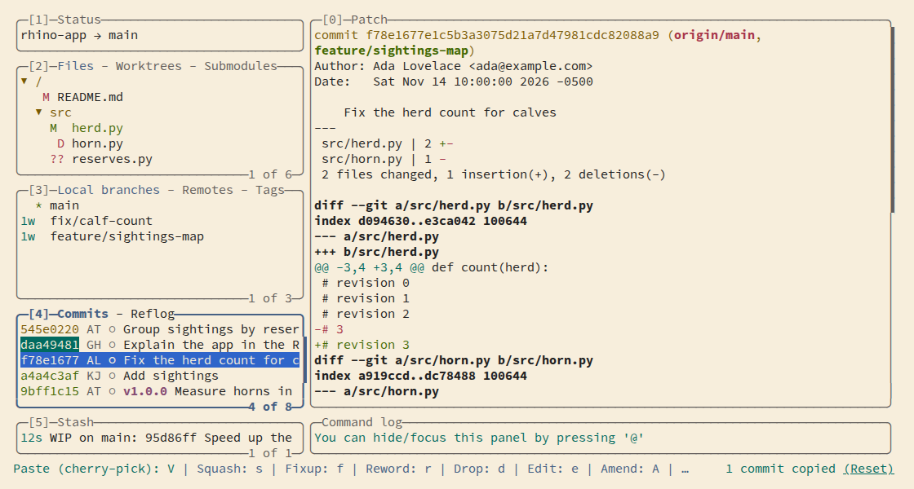

<p align="center">
  <picture>
    <source media="(prefers-color-scheme: dark)" srcset="docs/images/logo-dark.svg">
    
  </picture>
</p>

<h1 align="center">Critical Rhino</h1>

<p align="center">
  A warm color scheme for editors and terminals, in dark and light,<br>
  where every color the theme sets is measured on every surface it's drawn on.
</p>

<p align="center">
  <a href="https://matthewaburton.github.io/critical-rhino/"><b>See the palette and every role on the site</b></a>
</p>

Cream text on near-black, or near-black on cream, with orange keywords, red strings,
green comments, purple numbers and blue types. Both variants come from one palette,
[`palette.toml`](palette.toml), and every theme here is generated from it and then
checked: each text color is measured against every surface it can land on, at 4.5:1
for text and 3:1 for dim text and marks, and where it can be, in the real app.

<table>
  <tr><th colspan="2">Neovim</th></tr>
  <tr>
    <td></td>
    <td></td>
  </tr>
  <tr><th colspan="2">VS Code</th></tr>
  <tr>
    <td></td>
    <td></td>
  </tr>
  <tr><th colspan="2">Ghostty, with starship</th></tr>
  <tr>
    <td></td>
    <td></td>
  </tr>
  <tr><th colspan="2">lazygit</th></tr>
  <tr>
    <td></td>
    <td></td>
  </tr>
</table>

## What's included

| Tool | Theme | Switching between dark and light |
|---|---|---|
| [Neovim](#neovim) 0.10+ | `colors/`, `lua/` | Follows `'background'`, which Neovim sets from the terminal |
| [VS Code and Cursor](#vs-code-and-cursor) | `extras/vscode/` | Follows the desktop, with `window.autoDetectColorScheme` |
| [Ghostty](#ghostty) 1.3+ | `extras/ghostty/` | Follows the desktop |
| [starship](#starship), [fzf](#fzf), [lazygit](#lazygit), [tmux](#tmux) | `extras/<tool>/` | Follow the terminal: they draw in its 16 colors |

The terminal tools' themes work in any terminal. They're measured against Ghostty
with this theme; in a terminal with another palette, they draw in that palette's
colors.

## Install

Neovim installs as a plugin and VS Code from a download. For everything else, clone
the repo somewhere it can stay. The examples below assume `~/critical-rhino`:

```sh
git clone https://github.com/matthewaburton/critical-rhino.git ~/critical-rhino
```

### Neovim

It's a standard colorscheme plugin. With [lazy.nvim](https://github.com/folke/lazy.nvim):

```lua
{
  "matthewaburton/critical-rhino",
  lazy = false,
  priority = 1000,
  config = function()
    vim.cmd.colorscheme("critical-rhino")
  end,
},
```

To update only when there's a new [release](https://github.com/matthewaburton/critical-rhino/releases),
add `version = "*"` to the spec.

`critical-rhino` follows `'background'`, so `:set background=light` switches to the
light variant; `critical-rhino-dark` and `critical-rhino-light` pick one. With
[LazyVim](https://www.lazyvim.org), set it as the colorscheme instead:

```lua
-- ~/.config/nvim/lua/plugins/colorscheme.lua
return {
  { "matthewaburton/critical-rhino", lazy = false, priority = 1000 },
  { "LazyVim/LazyVim", opts = { colorscheme = "critical-rhino" } },
}
```

lualine picks up the matching theme by itself. If you use bufferline, hand it the
theme's tab colors too, since it paints its file icons on a shade a colorscheme
can't reach:

```lua
{
  "akinsho/bufferline.nvim",
  optional = true,
  opts = function(_, opts)
    opts.highlights = require("critical-rhino").bufferline
  end,
},
```

### VS Code and Cursor

The extension isn't on the Marketplace yet. Download `critical-rhino-<version>.vsix`
from the [latest release](https://github.com/matthewaburton/critical-rhino/releases/latest)
and install it with **Extensions: Install from VSIX...**, or from a terminal:

```sh
code --install-extension critical-rhino-<version>.vsix
cursor --install-extension critical-rhino-<version>.vsix
```

Or build it from the clone (this needs Python 3.11 or later and nothing else) and
install it into every copy of VS Code and Cursor on your machine with
`make vscode:install`; `make vscode:package` only writes the `.vsix` into `build/`.

Then pick **Critical Rhino Dark** or **Critical Rhino Light** with
**Preferences: Color Theme**, or follow the desktop:

```jsonc
// settings.json
"window.autoDetectColorScheme": true,
"workbench.preferredDarkColorTheme": "Critical Rhino Dark",
"workbench.preferredLightColorTheme": "Critical Rhino Light"
```

VS Code lifts any terminal color below 4.5:1 as it draws
(`terminal.integrated.minimumContrastRatio`). If you turn that off to see the theme's
own terminal colors, also turn off `terminal.integrated.drawBoldTextInBrightColors`
for the light theme, where bright white is the background.

### Ghostty

Point `theme` at both files by absolute path, and Ghostty follows the desktop:

```ini
# ~/.config/ghostty/config.ghostty
theme = light:/home/you/critical-rhino/extras/ghostty/critical-rhino-light,dark:/home/you/critical-rhino/extras/ghostty/critical-rhino-dark
```

Colors in your own config override the theme's, so remove any `background`,
`foreground`, `palette`, `selection-*`, `cursor-color` and `bold-is-bright` lines.
To see what Ghostty is drawing, run `make term:test` in it (outside tmux): it names
any color that doesn't match the theme and prints every color in every style.

### starship

```sh
# ~/.bashrc
export STARSHIP_CONFIG=~/critical-rhino/extras/starship/critical-rhino.toml
```

Starship reads a single config file, so if you have your own, copy the theme's
tables into it instead. They only replace the default styles that use fixed colors.

### fzf

```sh
# ~/.bashrc, before fzf's key bindings
. ~/critical-rhino/extras/fzf/critical-rhino.sh
```

It appends its colors to `FZF_DEFAULT_OPTS`, so your other options stay. If fzf
isn't hooked into your shell yet, add its key bindings after it: `eval "$(fzf --bash)"`
on fzf 0.48 or later, or your distribution's `key-bindings.bash`.

### lazygit

```sh
# ~/.bashrc
export LG_CONFIG_FILE=~/critical-rhino/extras/lazygit/critical-rhino.yml
# or, to keep your own config, list it first:
export LG_CONFIG_FILE="$HOME/.config/lazygit/config.yml,$HOME/critical-rhino/extras/lazygit/critical-rhino.yml"
```

### tmux

```sh
# ~/.tmux.conf
source-file ~/critical-rhino/extras/tmux/critical-rhino.conf
```

It sets only colors: the status bar, borders, messages, the copy-mode selection and
search matches. Layout and status-line contents stay yours.

## How it's checked

Every theme has a check that measures each color it sets against every background
it's drawn on, and refuses to write a theme that fails. `make check` runs them all.
Three audits go further and measure what the real apps draw:

- `make nvim:audit` starts your own Neovim config headless with the theme and
  measures every highlight group your plugins define.
- `make vscode:audit` runs VS Code and Cursor headless, steps through ten scenes
  (diffs, merges, find, hovers, the terminal, ...) and measures every run of text and
  every icon against the pixels behind it.
- `make terminal:audit` runs starship, fzf and lazygit in a private tmux and measures
  every character they draw, as Ghostty would draw it.

A few things the tools hard-code are out of a theme's reach. Those are measured and
listed, not hidden: see [the design notes](docs/design.md), which also explain every
color choice.

## Building from source

`palette.toml` is the source of truth; the themes in `colors/`, `lua/` and `extras/`
are generated from it and committed, so using them needs no build step. The scripts
need Python 3.11 or later and use only the standard library. Linting uses
[ruff](https://docs.astral.sh/ruff/), which `make setup` installs into `./bin` with
[uv](https://docs.astral.sh/uv/).

```sh
make                 # list every command
make doctor          # check Python, uv, ruff and the tools the themes are for
make derive          # after changing a rule in palette.toml: refresh the derived hex values
make build           # regenerate every theme, the logo and the site
make check           # every check, and lint; run before committing
make screenshots     # after changing colors: retake the screenshots on this page (slow)
make site            # just the site: open build/site/index.html
```

Releases are annotated `vX.Y.Z` tags. Pushing one runs the checks again, publishes
the release with the VS Code extension attached, and deploys the site;
[AGENTS.md](AGENTS.md) has the steps and the numbering rules.

| Path | What it is |
|---|---|
| `palette.toml` | The palette: base colors, derived colors, and the syntax, UI and terminal roles |
| `colors/`, `lua/` | The Neovim plugin. `lua/critical-rhino/{dark,light}.lua` are generated |
| `extras/` | The other themes, one folder per tool, all generated |
| `scripts/rhino.py` | Loads the palette and does the color math every script shares |
| `scripts/check.py`, `derive.py` | Check the palette; refresh its derived colors |
| `scripts/build_<tool>.py` | Build one theme and check every pair in it |
| `scripts/audit_<target>.py` | Run the real apps and measure what they draw |
| `scripts/screenshots.py` | Retake the screenshots on this page from the current themes |
| `scripts/preview.py`, `logo.py`, `term_test.py` | The site, the logo, and a terminal color test |
| `docs/` | [Design notes](docs/design.md) and the images on this page |
| `AGENTS.md` | Guidance for AI agents working here (`CLAUDE.md` links to it), and the release steps |
| `.github/workflows/` | `make check` on every push; releases and the site on every tag |

## License

[MIT](LICENSE)
