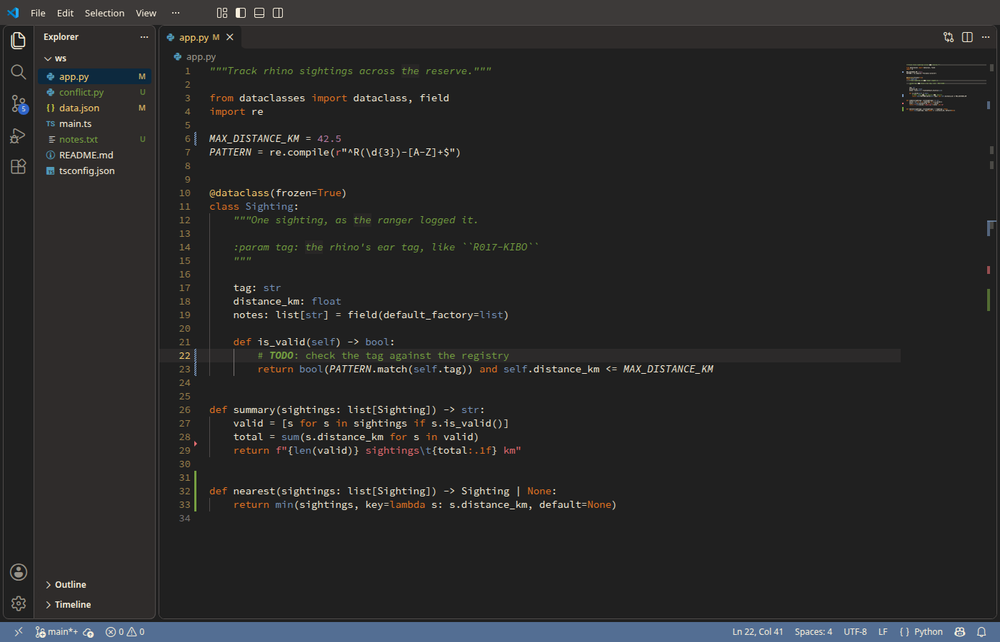
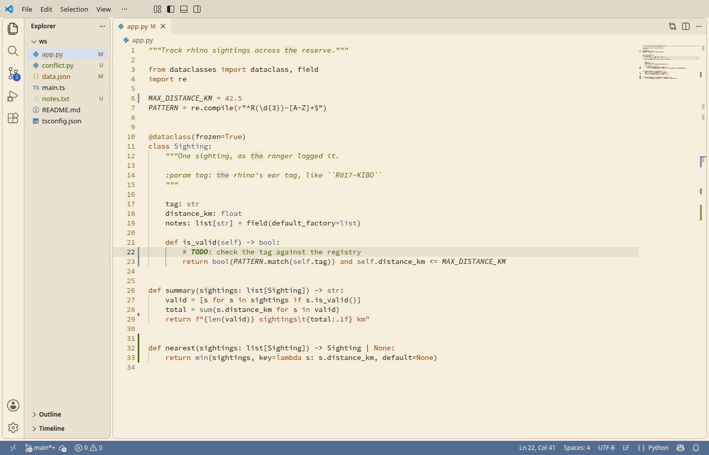

# Critical Rhino

A warm color theme in dark and light: cream text on near-black, or near-black on
cream, with orange keywords, red strings, green comments, purple numbers and blue
types. Every text color the theme sets is measured on every surface the editor draws
it on, at 4.5:1 for text and 3:1 for dim text and marks.





## Use it

Pick **Critical Rhino Dark** or **Critical Rhino Light** with **Preferences: Color
Theme**, or follow the desktop:

```jsonc
// settings.json
"window.autoDetectColorScheme": true,
"workbench.preferredDarkColorTheme": "Critical Rhino Dark",
"workbench.preferredLightColorTheme": "Critical Rhino Light"
```

VS Code lifts any terminal color below 4.5:1 as it draws
(`terminal.integrated.minimumContrastRatio`). If you turn that off to see the theme's
own terminal colors, also turn off `terminal.integrated.drawBoldTextInBrightColors`
for the light theme, where bright white is the background.

## The rest of the scheme

The same palette themes Neovim, Ghostty, starship, fzf, lazygit, tmux and Claude
Code. The [site](https://matthewaburton.github.io/critical-rhino/) shows every color and the role it plays, and the
[repository](https://github.com/matthewaburton/critical-rhino) has the other themes, the design notes and the
[release notes](https://github.com/matthewaburton/critical-rhino/releases).

Found a color that doesn't read? [Open an issue](https://github.com/matthewaburton/critical-rhino/issues).
